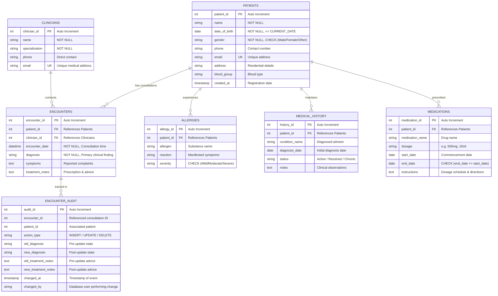

# MediTrack – Entity-Relationship (ER) Diagram

This document illustrates the conceptual and logical schema for the **MediTrack – Patient Health Records** database system.

---

## 1. Visual EER Diagram (Mermaid)

---

## 2. Structural Relationship Cardinalities

| Entity A | Relationship | Entity B | Cardinality | Participation | Foreign Key in Child Entity |
|---|---|---|---|---|---|
| **Patients** | records | **Encounters** | 1 : N (One-to-Many) | Mandatory (1) to Optional (N) | `Encounters.patient_id` |
| **Clinicians** | conducts | **Encounters** | 1 : N (One-to-Many) | Mandatory (1) to Optional (N) | `Encounters.clinician_id` |
| **Patients** | experiences | **Allergies** | 1 : N (One-to-Many) | Mandatory (1) to Optional (N) | `Allergies.patient_id` |
| **Patients** | has diagnosed | **Medical_History** | 1 : N (One-to-Many) | Mandatory (1) to Optional (N) | `Medical_History.patient_id` |
| **Patients** | is prescribed | **Medications** | 1 : N (One-to-Many) | Mandatory (1) to Optional (N) | `Medications.patient_id` |
| **Encounters** | triggers log | **Encounter_Audit** | 1 : N (One-to-Many) | Mandatory (1) to Optional (N) | `Encounter_Audit.encounter_id` |

---

## 3. Referential Integrity Rules

1. **`Encounters.patient_id` &rarr; `Patients.patient_id`**:
   - `ON DELETE RESTRICT`: Prevents deletion of any patient who has clinical consultation history.
   - `ON UPDATE CASCADE`: If patient ID changes, all related encounters cascade update.
2. **`Encounters.clinician_id` &rarr; `Clinicians.clinician_id`**:
   - `ON DELETE RESTRICT`: Clinicians with patient consultation records cannot be removed.
   - `ON UPDATE CASCADE`: Updates to clinician IDs reflect across consultations.
3. **`Allergies.patient_id` &rarr; `Patients.patient_id`**:
   - `ON DELETE RESTRICT`: Protects against orphaned allergy records.
4. **`Medical_History.patient_id` &rarr; `Patients.patient_id`**:
   - `ON DELETE RESTRICT`: Preserves chronic diagnosis integrity.
5. **`Medications.patient_id` &rarr; `Patients.patient_id`**:
   - `ON DELETE RESTRICT`: Active drug histories cannot be orphaned.
