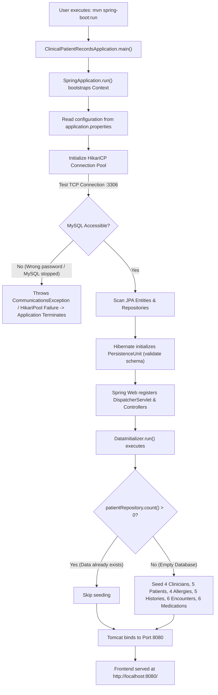

# MediTrack – Patient Health Records
## Document 3: Complete Application Workflow

---

## 1. Application Startup Workflow

### 1.1 Startup Execution Chain



### 1.2 Step-by-Step Startup Details

1. **Backend Initialization**:
   - The user executes `mvn spring-boot:run` inside the `backend/` directory.
   - Java executes `ClinicalPatientRecordsApplication.java`, invoking `SpringApplication.run()`.
2. **Configuration Ingestion**:
   - Spring Boot parses `src/main/resources/application.properties`:
     ```properties
     spring.datasource.url=jdbc:mysql://localhost:3306/clinical_patient_db?createDatabaseIfNotExist=true&useSSL=false&allowPublicKeyRetrieval=true&serverTimezone=UTC
     spring.datasource.username=root
     spring.datasource.password=17May@2006
     spring.jpa.hibernate.ddl-auto=update
     ```
3. **Database Handshake & Connection Pool Setup**:
   - `HikariCP` initializes a JDBC connection pool to `localhost:3306`.
   - **What happens if MySQL fails or password is wrong?**
     HikariCP throws `java.sql.SQLNonTransientConnectionException: Cannot create PoolableConnectionFactory` and the Spring Boot startup sequence halts with a non-zero exit code. The embedded web server does not start.
4. **Data Seeding (`DataInitializer.java`)**:
   - Implements `CommandLineRunner`. Its `run()` method checks `patientRepository.count()`.
   - If the count is 0, it automatically populates initial fictional records (4 clinicians, 5 patients, 4 allergies, 5 medical histories, 6 encounters, and 6 medications). If records already exist, seeding is safely bypassed.
5. **Frontend Serving**:
   - Embedded Tomcat 10 starts on port `8080`.
   - Spring Boot's `WelcomePageHandlerMapping` detects `src/main/resources/static/index.html` and maps it to root URL `http://localhost:8080/`.

---

## 2. Dashboard Workflow

### 2.1 Workflow Steps:
1. When the user navigates to `http://localhost:8080/`, `DOMContentLoaded` in `js/app.js` automatically calls `loadDashboard()`.
2. `loadDashboard()` initiates two asynchronous HTTP requests:
   - `GET /api/dashboard/stats`: Invokes `DashboardService.getStats()`, which runs `patientRepository.count()` and `encounterRepository.count()`.
   - `GET /api/dashboard/recent-patients`: Invokes `DashboardService.getRecentPatients()`, which executes `patientRepository.findTop5ByOrderByPatientIdDesc()`.
3. **Live Database Verification**: The counts displayed on screen are **100% dynamic** from live SQL `COUNT(*)` queries, not hardcoded. When a new patient or encounter is recorded anywhere in the app, the dashboard metrics update immediately upon tab switch.

---

## 3. Patient Management Workflow

### 3.1 Patient Registration (Create)
1. User clicks **+ Register New Patient**, opening the patient registration form panel.
2. Form fields entered: Full Name, Date of Birth (calendar input), Gender (dropdown), Blood Group (dropdown), Phone Number, and Street Address.
3. On clicking **Save Patient**:
   - JavaScript validates that `name`, `dateOfBirth`, and `gender` are not blank.
   - A `POST` request is dispatched to `/api/patients` with a JSON payload.
   - `PatientController.createPatient()` validates the payload using Jakarta Bean Validation (`@Valid`).
   - `PatientService.createPatient()` calls `patientRepository.save(patient)`.
   - Hibernate generates:
     ```sql
     INSERT INTO Patients (name, date_of_birth, gender, phone, email, blood_group, address, created_at)
     VALUES ('Lucas Gray', '1995-07-30', 'Male', '9545678901', NULL, 'O-', '77 Sunset Strip', NOW());
     ```
   - Before insertion, MySQL trigger `trg_patients_validate_dob_insert` verifies that `date_of_birth <= CURDATE()`. If valid, MySQL generates an auto-incremented `patient_id`.
   - The backend responds with HTTP 201 Created.
   - The frontend displays a green success banner, resets the form, hides the form panel, and reloads the table and dropdowns.

### 3.2 Patient Search
1. The user types a name substring (e.g. `emily`) or exact patient ID (e.g. `2`) into the search field and presses Enter or clicks **Search**.
2. JavaScript triggers `GET /api/patients?search=emily`.
3. `PatientRepository.searchPatients()` executes the custom JPQL query:
   ```sql
   SELECT p FROM Patient p 
   WHERE LOWER(p.name) LIKE LOWER(CONCAT('%', :query, '%')) 
      OR CAST(p.patientId AS string) = :query;
   ```
4. The matching patient records are returned as JSON and rendered in the table. Clicking **Reset** clears the search and calls `loadPatients()` to fetch all records.

### 3.3 Patient Update (Edit)
1. User clicks **Edit** on any patient row.
2. `startEditPatient(id)` fetches the existing record via `GET /api/patients/{id}`.
3. Form fields are pre-populated with current values, the title changes to `Edit Patient Details (ID #...)`, and the submit button changes to `Update Patient`.
4. On submit, JavaScript issues a `PUT /api/patients/{id}` request with the updated JSON.
5. `PatientService.updatePatient()` updates the managed entity and persists changes to MySQL.

### 3.4 Patient Deletion & Referential Integrity Guard
1. User clicks **Delete** on a patient row.
2. A browser confirmation dialog warns the user that deletion will be rejected if active clinical relationships exist.
3. On confirmation, JavaScript issues `DELETE /api/patients/{id}`.
4. `PatientService.deletePatient(id)` performs relational integrity checks:
   ```java
   long encounterCount = encounterRepository.countByPatientPatientId(id);
   long allergyCount = allergyRepository.countByPatientPatientId(id);
   long historyCount = medicalHistoryRepository.countByPatientPatientId(id);
   long medicationCount = medicationRepository.countByPatientPatientId(id);

   if (encounterCount > 0 || allergyCount > 0 || historyCount > 0 || medicationCount > 0) {
       throw new DatabaseConstraintException("Cannot delete patient ID " + id + " because active relationships exist...");
   }
   patientRepository.delete(patient);
   ```
5. **Demonstration Scenarios**:
   - **Patient #1 (John Doe)**: Has 2 encounters, 1 allergy, 2 medical histories, and 2 medications. `PatientService` intercepts the request and throws `DatabaseConstraintException`. `GlobalExceptionHandler` converts this into HTTP 409 Conflict with a detailed message. The frontend displays a red alert banner and the record is preserved.
   - **Patient #5 (Lucas Gray)**: Has 0 encounters, 0 allergies, 0 medical histories, and 0 medications. All count checks return 0. The service executes `patientRepository.delete()`, MySQL deletes the row, and the frontend updates the list.

---

## 4. Clinician Management Workflow

1. User opens the **Clinicians** tab.
2. Existing medical staff members are loaded via `GET /api/clinicians` and rendered in the clinicians table with their assigned medical specialization.
3. To add a clinician:
   - User inputs clinician name (e.g. `Dr. Gregory House`) and specialty (e.g. `Diagnostic Medicine`).
   - Form submits via `POST /api/clinicians` with `{name, specialty}`.
   - `ClinicianController` receives the request and invokes `ClinicianService.createClinician()`.
   - Hibernate executes `INSERT INTO Clinicians (name, specialization) VALUES (...)`.
   - The UI reloads the clinician table and updates the clinician select dropdown in the Encounters tab.

---

## 5. Clinical Encounters & Audit Workflow

### 5.1 Recording an Encounter
1. User opens the **Encounters** tab.
2. The form automatically fetches and populates:
   - Registered patients in the **Patient** select dropdown (`loadPatientsDropdown()`).
   - Available doctors in the **Attending Clinician** select dropdown (`loadCliniciansDropdown()`).
   - Current local date and time in the **Encounter Date & Time** input (`resetEncounterDate()`).
3. The clinician inputs:
   - **Diagnosis**: Mandatory (e.g. `Acute Bronchitis`).
   - **Symptoms**: Free-text clinical description (e.g. `Persistent dry cough and wheezing for 5 days`).
   - **Treatment Notes & Prescriptions**: Clinical recommendations and pharmacotherapy instructions.
4. On clicking **Record Encounter**:
   - JavaScript sends a `POST` request to `/api/encounters` with:
     ```json
     {
       "patientId": 1,
       "clinicianId": 2,
       "encounterDate": "2026-10-25T15:30",
       "diagnosis": "Acute Bronchitis",
       "symptoms": "Persistent dry cough...",
       "treatmentNotes": "Prescribed Azithromycin 500mg..."
     }
     ```
   - `EncounterService.recordEncounter()` verifies that both the `patientId` and `clinicianId` exist in the database (throwing `ResourceNotFoundException` if either is missing).
   - An `Encounter` entity is saved via `encounterRepository.save(encounter)`.
   - **Automated MySQL Audit Trigger**:
     As soon as the `INSERT INTO Encounters` executes in MySQL, the database trigger `trg_after_encounter_insert` automatically fires and writes an immutable audit entry into `Encounter_Audit`:
     ```sql
     INSERT INTO Encounter_Audit (encounter_id, patient_id, action_type, new_diagnosis, new_treatment_notes, changed_at, changed_by)
     VALUES (NEW.encounter_id, 1, 'INSERT', 'Acute Bronchitis', 'Prescribed Azithromycin...', NOW(), CURRENT_USER());
     ```
   - The UI updates the table of recent clinical encounters in reverse chronological order (`loadAllEncounters()`).

---

## 6. Comprehensive Patient Dossier Workflow

1. From the **Dashboard** (Recently Added Patients) or **Patients** (All Registered Patients) tab, the user clicks **Details** / **View Details** on a patient.
2. JavaScript calls `viewPatientDetails(patientId)`.
3. The browser calls `GET /api/patients/{id}/details`.
4. `PatientService.getPatientDetails(id)` coordinates four parallel relational queries:
   - Demographic information from `PatientRepository`.
   - All diagnosed allergies from `AllergyRepository.findByPatientPatientId(id)`.
   - Chronic and past medical conditions from `MedicalHistoryRepository.findByPatientPatientId(id)`.
   - Complete consultation history from `EncounterRepository.findByPatientPatientIdOrderByEncounterDateDesc(id)`.
5. The backend packages this data into a `PatientDetailsDTO` and returns HTTP 200 OK.
6. The frontend dynamically switches to the `patient-details` tab and renders:
   - **Patient Demographic Card**: Full Name, ID, Age (computed from DOB), Blood Group, Phone, Address, and Registration Timestamp.
   - **Known Allergies Table**: Allergen, reaction, and severity (color-coded red for `Severe`).
   - **Past Medical History Table**: Condition name, diagnosis date, and clinical status (`Active`, `Resolved`, `Chronic`).
   - **Encounter History Table**: Consultation timeline listing date, attending clinician, diagnosis, symptoms, and treatment notes.
   - **Quick Action Button**: `+ Record Encounter for this Patient`, which pre-selects the current patient in the encounter recording form.
