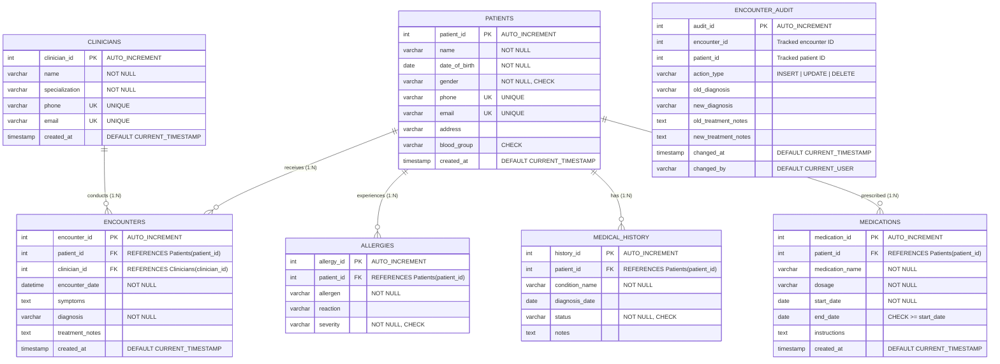

# MediTrack – Patient Health Records
## Document 4: Relational Database Design, ER Modeling & BCNF Normalization

---

## 1. Schema Architecture & Physical Table Inventory

All seven tables documented below are defined in [`database/01_schema_constraints.sql`](file:///c:/Users/Aryan/OneDrive/Desktop/DBMS MiniProject/database/01_schema_constraints.sql) and are currently active inside the MySQL `clinical_patient_db` database:

```text
Table Existence Status in MySQL Server:
1. patients         -> [EXISTS - ACTIVE]
2. clinicians       -> [EXISTS - ACTIVE]
3. encounters       -> [EXISTS - ACTIVE]
4. allergies        -> [EXISTS - ACTIVE]
5. medical_history  -> [EXISTS - ACTIVE]
6. medications      -> [EXISTS - ACTIVE]
7. encounter_audit  -> [EXISTS - ACTIVE]
```

---

## 2. Detailed Table Specifications

### 2.1 Table: `Patients`
- **Purpose**: Stores primary demographic and contact records for all registered individuals.
- **Primary Key**: `patient_id` (INT, AUTO_INCREMENT)
- **Foreign Keys**: None (Independent Parent Table).
- **Unique Constraints**:
  - `phone` (VARCHAR(20), UNIQUE)
  - `email` (VARCHAR(100), UNIQUE)
- **Check Constraints**:
  - `chk_patient_gender`: `CHECK (gender IN ('Male', 'Female', 'Other'))`
  - `chk_patient_blood_group`: `CHECK (blood_group IS NULL OR blood_group IN ('A+', 'A-', 'B+', 'B-', 'AB+', 'AB-', 'O+', 'O-'))`
- **Trigger Constraints**:
  - `trg_patients_validate_dob_insert` & `trg_patients_validate_dob_update`: Enforce that `date_of_birth <= CURDATE()`.
- **Relationships**:
  - One-to-Many with `Encounters` (1:N)
  - One-to-Many with `Allergies` (1:N)
  - One-to-Many with `Medical_History` (1:N)
  - One-to-Many with `Medications` (1:N)

### 2.2 Table: `Clinicians`
- **Purpose**: Master registry of physicians, specialists, and attending healthcare practitioners.
- **Primary Key**: `clinician_id` (INT, AUTO_INCREMENT)
- **Foreign Keys**: None (Independent Parent Table).
- **Unique Constraints**:
  - `phone` (VARCHAR(20), UNIQUE)
  - `email` (VARCHAR(100), UNIQUE)
- **Column Attributes**: `name` (VARCHAR(100), NOT NULL), `specialization` (VARCHAR(100), NOT NULL).
- **Relationships**:
  - One-to-Many with `Encounters` (1:N)

### 2.3 Table: `Encounters`
- **Purpose**: Relational bridge recording clinical consultations between patients and clinicians.
- **Primary Key**: `encounter_id` (INT, AUTO_INCREMENT)
- **Foreign Keys**:
  - `fk_encounters_patient`: `patient_id` &rarr; `Patients(patient_id)` (`ON DELETE RESTRICT ON UPDATE CASCADE`)
  - `fk_encounters_clinician`: `clinician_id` &rarr; `Clinicians(clinician_id)` (`ON DELETE RESTRICT ON UPDATE CASCADE`)
- **Check Constraints**:
  - `chk_encounter_diagnosis`: `CHECK (CHAR_LENGTH(TRIM(diagnosis)) > 0)`
- **Indexes**:
  - Composite Index: `idx_encounters_patient_date` on `(patient_id, encounter_date DESC)`
  - Index on `encounter_date`: `idx_encounters_date`
- **Relationships**:
  - Many-to-One with `Patients` (N:1)
  - Many-to-One with `Clinicians` (N:1)

### 2.4 Table: `Allergies`
- **Purpose**: Tracks patient hypersensitivities, allergic triggers, and reaction severity.
- **Primary Key**: `allergy_id` (INT, AUTO_INCREMENT)
- **Foreign Keys**:
  - `fk_allergies_patient`: `patient_id` &rarr; `Patients(patient_id)` (`ON DELETE RESTRICT ON UPDATE CASCADE`)
- **Check Constraints**:
  - `chk_allergy_severity`: `CHECK (severity IN ('Mild', 'Moderate', 'Severe'))`
- **Relationships**:
  - Many-to-One with `Patients` (N:1)

### 2.5 Table: `Medical_History`
- **Purpose**: Retains chronic conditions, past clinical diagnoses, and their ongoing status.
- **Primary Key**: `history_id` (INT, AUTO_INCREMENT)
- **Foreign Keys**:
  - `fk_history_patient`: `patient_id` &rarr; `Patients(patient_id)` (`ON DELETE RESTRICT ON UPDATE CASCADE`)
- **Check Constraints**:
  - `chk_history_status`: `CHECK (status IN ('Active', 'Resolved', 'Chronic'))`
- **Trigger Constraints**:
  - `trg_med_history_validate_date_insert` & `trg_med_history_validate_date_update`: Enforce that `diagnosis_date <= CURDATE()`.
- **Relationships**:
  - Many-to-One with `Patients` (N:1)

### 2.6 Table: `Medications`
- **Purpose**: Tracks pharmacotherapy regimens and prescriptions prescribed to patients.
- **Primary Key**: `medication_id` (INT, AUTO_INCREMENT)
- **Foreign Keys**:
  - `fk_medications_patient`: `patient_id` &rarr; `Patients(patient_id)` (`ON DELETE RESTRICT ON UPDATE CASCADE`)
- **Check Constraints**:
  - `chk_medication_dates`: `CHECK (end_date IS NULL OR end_date >= start_date)`
- **Relationships**:
  - Many-to-One with `Patients` (N:1)

### 2.7 Table: `Encounter_Audit`
- **Purpose**: Immutable security audit log tracking lifecycle changes (`INSERT`, `UPDATE`, `DELETE`) on clinical encounters.
- **Primary Key**: `audit_id` (INT, AUTO_INCREMENT)
- **Foreign Keys**: Intentionally unconstrained by foreign keys to preserve historic audit trails even if referenced records are purged.
- **Check Constraints**:
  - `chk_audit_action`: `CHECK (action_type IN ('INSERT', 'UPDATE', 'DELETE'))`
- **Default Columns**:
  - `changed_at`: `TIMESTAMP DEFAULT CURRENT_TIMESTAMP`
  - `changed_by`: `VARCHAR(100) DEFAULT (CURRENT_USER())`

---

## 3. Entity-Relationship (ER) Diagram



---

## 4. Normalization Analysis & BCNF Proof

### 4.1 Definition of Boyce-Codd Normal Form (BCNF)
A relation $R$ is in **Boyce-Codd Normal Form (BCNF)** if and only if, for every non-trivial functional dependency $X \rightarrow Y$, $X$ is a **superkey** of $R$.

### 4.2 Entity-by-Entity Verification

#### Entity 1: `Patients`
- **Attributes**: `(patient_id, name, date_of_birth, gender, phone, email, address, blood_group, created_at)`
- **Candidate Keys**: 
  1. `patient_id` (Primary Key)
  2. `email` (Unique Key)
  3. `phone` (Unique Key)
- **Functional Dependencies (FDs)**:
  - $FD_1: \text{patient\_id} \rightarrow \{\text{name, date\_of\_birth, gender, phone, email, address, blood\_group, created\_at}\}$
  - $FD_2: \text{email} \rightarrow \{\text{patient\_id, name, date\_of\_birth, gender, phone, address, blood\_group, created\_at}\}$
  - $FD_3: \text{phone} \rightarrow \{\text{patient\_id, name, date\_of\_birth, gender, email, address, blood\_group, created\_at}\}$
- **BCNF Evaluation**:
  In each dependency $FD_1, FD_2, FD_3$, the determinant is a candidate key (and thus a superkey). There are no transitive dependencies. **`Patients` is strictly in BCNF.**

#### Entity 2: `Clinicians`
- **Attributes**: `(clinician_id, name, specialization, phone, email, created_at)`
- **Candidate Keys**:
  1. `clinician_id` (Primary Key)
  2. `email` (Unique Key)
  3. `phone` (Unique Key)
- **Functional Dependencies**:
  - $FD_1: \text{clinician\_id} \rightarrow \{\text{name, specialization, phone, email, created\_at}\}$
  - $FD_2: \text{email} \rightarrow \{\text{clinician\_id, name, specialization, phone, created\_at}\}$
  - $FD_3: \text{phone} \rightarrow \{\text{clinician\_id, name, specialization, email, created\_at}\}$
- **BCNF Evaluation**:
  All determinants are candidate keys. **`Clinicians` is strictly in BCNF.**

#### Entity 3: `Encounters`
- **Attributes**: `(encounter_id, patient_id, clinician_id, encounter_date, symptoms, diagnosis, treatment_notes, created_at)`
- **Candidate Keys**:
  1. `encounter_id` (Primary Key)
  2. `(patient_id, clinician_id, encounter_date)` (Composite Candidate Key, assuming a patient cannot have two consultations with the same clinician at the exact same second).
- **Functional Dependencies**:
  - $FD_1: \text{encounter\_id} \rightarrow \{\text{patient\_id, clinician\_id, encounter\_date, symptoms, diagnosis, treatment\_notes, created\_at}\}$
  - $FD_2: \{\text{patient\_id, clinician\_id, encounter\_date}\} \rightarrow \{\text{encounter\_id, symptoms, diagnosis, treatment\_notes, created\_at}\}$
- **BCNF Evaluation**:
  Both determinants are superkeys. There are no partial dependencies on any candidate key subset, and no non-key attribute determines another non-key attribute. **`Encounters` is strictly in BCNF.**

#### Entity 4: `Allergies`
- **Attributes**: `(allergy_id, patient_id, allergen, reaction, severity)`
- **Candidate Key**: `allergy_id` (Primary Key)
- **Functional Dependencies**:
  - $FD_1: \text{allergy\_id} \rightarrow \{\text{patient\_id, allergen, reaction, severity}\}$
- **BCNF Evaluation**:
  The only determinant is `allergy_id`, which is a superkey. **`Allergies` is strictly in BCNF.**

#### Entity 5: `Medical_History`
- **Attributes**: `(history_id, patient_id, condition_name, diagnosis_date, status, notes)`
- **Candidate Key**: `history_id` (Primary Key)
- **Functional Dependencies**:
  - $FD_1: \text{history\_id} \rightarrow \{\text{patient\_id, condition\_name, diagnosis\_date, status, notes}\}$
- **BCNF Evaluation**:
  The only determinant is `history_id`, which is a superkey. **`Medical_History` is strictly in BCNF.**

#### Entity 6: `Medications`
- **Attributes**: `(medication_id, patient_id, medication_name, dosage, start_date, end_date, instructions, created_at)`
- **Candidate Key**: `medication_id` (Primary Key)
- **Functional Dependencies**:
  - $FD_1: \text{medication\_id} \rightarrow \{\text{patient\_id, medication\_name, dosage, start\_date, end\_date, instructions, created\_at}\}$
- **BCNF Evaluation**:
  The only determinant is `medication_id`, which is a superkey. **`Medications` is strictly in BCNF.**

### 4.3 Summary Normalization Conclusion
Because every determinant across all six relational operational entities is a superkey, the MediTrack schema satisfies the requirements of **1NF** (atomic values), **2NF** (no partial dependencies), **3NF** (no transitive dependencies), and **Boyce-Codd Normal Form (BCNF)**.
