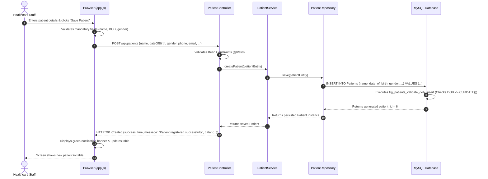
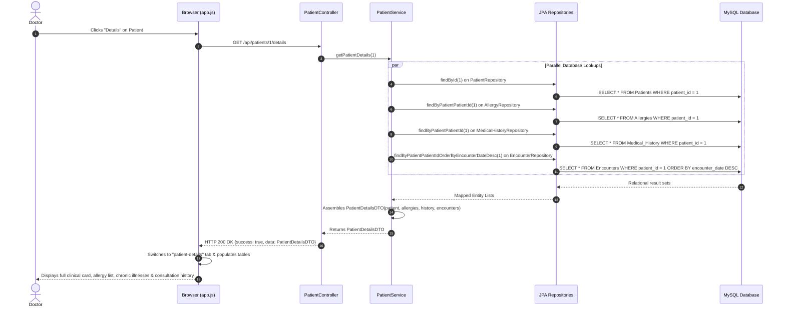

# MediTrack – Patient Health Records
## Document 2: System Architecture & Component Interaction

---

## 1. Architectural Model Overview

MediTrack implements a classic **Layered 3-Tier Enterprise Architecture** adhering to the **Separation of Concerns (SoC)** software design pattern. Each layer is strictly decoupled: the frontend has zero direct database knowledge and communicates solely via standard HTTP REST endpoints with JSON payloads; the Spring Boot backend encapsulates validation and business logic; and the MySQL database guarantees data persistence and relational integrity.

```mermaid
flowchart TD
    subgraph Tier1["Tier 1: Presentation Layer (Client Browser)"]
        UI["Vanilla HTML5 / CSS3 Interface"]
        JS["app.js (Asynchronous fetch API)"]
        UI <--> JS
    end

    subgraph Tier2["Tier 2: Application Layer (Spring Boot Backend :8080)"]
        TC["Tomcat Embedded Web Server"]
        
        subgraph ControllerLayer["Controller Layer"]
            PC["PatientController"]
            CC["ClinicianController"]
            EC["EncounterController"]
            DC["DashboardController"]
            GEH["GlobalExceptionHandler"]
        end
        
        subgraph ServiceLayer["Service Layer (Business Logic & Transactions)"]
            PS["PatientService (@Transactional)"]
            CS["ClinicianService"]
            ES["EncounterService (@Transactional)"]
            DS["DashboardService"]
        end
        
        subgraph RepositoryLayer["Repository Layer (Spring Data JPA)"]
            PR["PatientRepository"]
            CR["ClinicianRepository"]
            ER["EncounterRepository"]
            MR["MedicationRepository"]
            AR["AllergyRepository"]
            MHR["MedicalHistoryRepository"]
        end
        
        subgraph ORMLayer["ORM & Connection Pool"]
            HIB["Hibernate ORM 6.5.3"]
            HIK["HikariCP Connection Pool"]
        end
    end

    subgraph Tier3["Tier 3: Database Layer (MySQL Server :3306)"]
        DB[("clinical_patient_db (InnoDB)")]
        subgraph Tables["Relational Schema"]
            T_PAT["Patients"]
            T_CLN["Clinicians"]
            T_ENC["Encounters"]
            T_ALL["Allergies"]
            T_MED["Medications"]
            T_MH["Medical_History"]
            T_AUD["Encounter_Audit"]
        end
        subgraph Triggers["Database Triggers"]
            TRG_DOB["trg_patients_validate_dob_insert/update"]
            TRG_AUD["trg_after_encounter_insert/update/delete"]
        end
    end

    JS -->|HTTP GET/POST/PUT/DELETE (JSON)| TC
    TC --> ControllerLayer
    PC --> PS
    CC --> CS
    EC --> ES
    DC --> DS
    DS --> PS
    DS --> ES

    PS --> PR
    PS --> ER
    PS --> AR
    PS --> MHR
    PS --> MR
    CS --> CR
    ES --> ER
    ES --> PR
    ES --> CR

    RepositoryLayer --> HIB
    HIB --> HIK
    HIK -->|JDBC TCP/IP Socket (Port 3306)| DB
    DB --- Tables
    Tables --- Triggers
    ControllerLayer -.->|Standardized ApiResponse JSON| JS
```

---

## 2. Plain-Language Explanation of Architecture Layers

### Layer 1: Client Presentation Layer (Browser)
- **Files**: `frontend/index.html`, `frontend/css/style.css`, `frontend/js/app.js` (and their identical server-hosted copies in `backend/src/main/resources/static/`).
- **Function**: Renders forms, navigation tabs, statistics boxes, and data tables. JavaScript listens to DOM events (clicks, form submits, search keystrokes), prevents browser page reloads using `e.preventDefault()`, and triggers non-blocking asynchronous `fetch()` requests to the backend.

### Layer 2: Controller Layer (REST Controllers)
- **Classes**: `PatientController`, `ClinicianController`, `EncounterController`, `DashboardController`.
- **Function**: Acts as the entry gate for HTTP requests. Annotated with `@RestController` and `@RequestMapping("/api/...")`. 
  - Validates request payloads using Jakarta Bean Validation (`@Valid`, `@NotBlank`, `@NotNull`).
  - Converts incoming JSON strings into Java Request DTOs.
  - Passes valid data to the respective Service class.
  - Formats responses using the standardized `ApiResponse<T>` wrapper class returning HTTP status codes (200 OK, 201 Created, 400 Bad Request, 404 Not Found, 409 Conflict).

### Layer 3: Service Layer (Business Logic & Transactions)
- **Classes**: `PatientService`, `ClinicianService`, `EncounterService`, `DashboardService`.
- **Function**: The brain of the application. 
  - Coordinates multi-table logic.
  - Implements **Referential Integrity Guards** (e.g., verifying whether a patient has encounters, allergies, or medications before permitting a deletion in `PatientService.deletePatient`).
  - Manages transaction boundaries via `@Transactional` so changes are committed atomically.

### Layer 4: Data Access / Repository Layer (Spring Data JPA)
- **Interfaces**: `PatientRepository`, `ClinicianRepository`, `EncounterRepository`, `AllergyRepository`, `MedicalHistoryRepository`, `MedicationRepository`.
- **Function**: Extends `JpaRepository<Entity, Long>`. Automatically implements standard CRUD methods (`save()`, `findById()`, `findAll()`, `delete()`, `count()`) and compiles custom JPQL queries such as `searchPatients(@Param("query") String query)`.

### Layer 5: ORM & Persistence Engine (Hibernate & HikariCP)
- **Frameworks**: Hibernate 6.5.3 and HikariCP.
- **Function**: Translates object mutations on entities into optimized SQL dialect commands (`INSERT INTO patients...`, `SELECT e FROM Encounters e...`). HikariCP manages an efficient pool of pre-warmed database connections over JDBC to ensure fast execution without the overhead of creating a new socket connection for each request.

### Layer 6: Relational Database Layer (MySQL InnoDB)
- **Engine**: MySQL Community Server 9.6.0 on TCP port `3306`.
- **Database**: `clinical_patient_db`.
- **Function**: Enforces relational schema integrity through primary keys, foreign keys (`ON DELETE RESTRICT`), unique indexes, and deterministic CHECK constraints. Automatically fires database triggers for future-date validation and audit trails.

---

## 3. Detailed Request-Response Sequence Diagrams

### Sequence 1: Patient Registration (CRUD - Create)



---

### Sequence 2: Patient Deletion with Referential Integrity Enforcement

```mermaid
sequenceDiagram
    autonumber
    actor User as Staff User
    participant Browser as Browser (app.js)
    participant Ctrl as PatientController
    participant Svc as PatientService
    participant Repo as PatientRepository / EncounterRepo
    participant DB as MySQL Database

    User->>Browser: Clicks "Delete" button on Patient #1 (John Doe)
    Browser->>User: Prompts confirmation modal
    User->>Browser: Confirms deletion
    Browser->>Ctrl: DELETE /api/patients/1
    Ctrl->>Svc: deletePatient(1)
    Svc->>Repo: countByPatientPatientId(1) on Encounters, Allergies, History, Medications
    Repo->>DB: SELECT COUNT(*) FROM encounters WHERE patient_id = 1; (returns 2)
    Note over Svc: Integrity Check: encounterCount > 0!
    Svc-->>Ctrl: Throws DatabaseConstraintException("Cannot delete patient ID 1: active encounters exist.")
    Ctrl->>Ctrl: Handled by GlobalExceptionHandler
    Ctrl-->>Browser: HTTP 409 Conflict {success: false, message: "Cannot delete patient ID 1..."}
    Browser->>Browser: Displays red alert banner explaining referential protection
    Browser-->>User: Patient remains protected in database
```

---

### Sequence 3: Patient Clinical Dossier Retrieval


